<div align="center">


<h3>Read the game, keep the game.</h3>

在 Galgame 里读日语的小魔导书 ✦

[](https://megulit.com)
[](https://github.com/ilynthn/MeguLit/releases/latest)
[](#zh-install)
[](LICENSE)
[](https://github.com/sponsors/ilynthn)

**[下载 v1.3.0](https://github.com/ilynthn/MeguLit/releases/latest)** &nbsp;·&nbsp; **[官网 megulit.com](https://megulit.com)** &nbsp;·&nbsp; [简体中文](#zh) &nbsp;·&nbsp; [English](#en) &nbsp;·&nbsp; [日本語](#ja) &nbsp;·&nbsp; [常见问题](#faq) &nbsp;·&nbsp; [更新日志](https://github.com/ilynthn/MeguLit/releases) &nbsp;·&nbsp; [♡ 赞赏](#support)

<br>

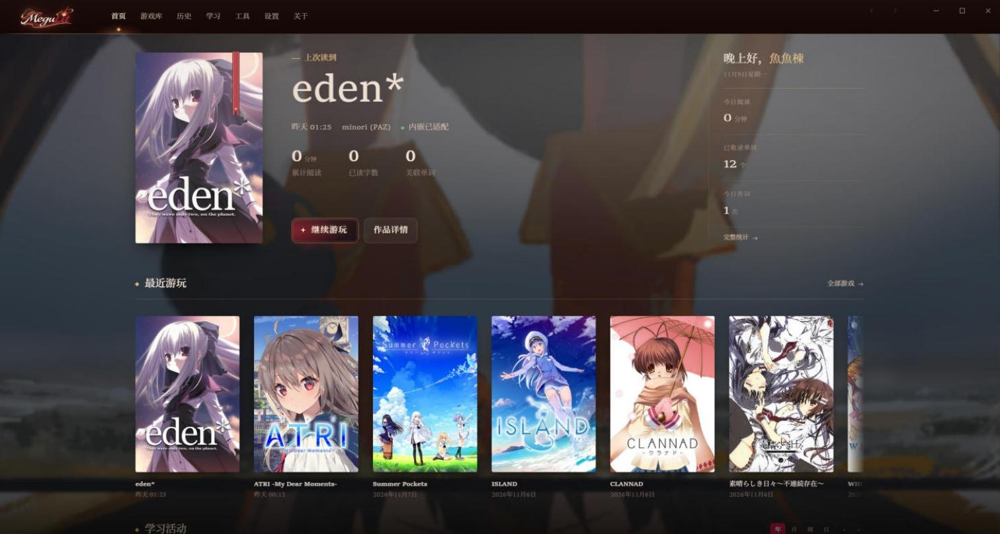

</div>

<br>

> [!WARNING]
> 还在积极开发中，功能、数据格式和界面随时可能变 &nbsp;·&nbsp; Still in active development &nbsp;·&nbsp; 開発中です

<br>

<a id="zh"></a>

# 简体中文

<a id="zh-new"></a>

## ✦ v1.2 新内容

| | |
|---|---|
| **零延迟翻译** | 你装过的汉化补丁直接当译文用：日文原文 + 汉化组的翻译，一句不等。KiriKiri、BGI、Siglus、YU-RIS、Artemis、Ren'Py 等引擎，euphoria、WHITE ALBUM2、月姬、千恋＊万花都已实测；没有汉化的句子提前机翻 |
| **日文原版恢复** | Steam 中文 / 英文版一键换回日文；也能直接选日文原版的压缩包、文件夹，甚至光盘镜像，MeguLit 自动对照替换，全部备份、一键还原 |
| **内嵌替换更多游戏** | YU-RIS 通用内嵌，64 位 KiriKiri，整页文字的魔法使之夜逐行对齐原文 |
| **省心** | 扫描范围跟着窗口和全屏自动调整 · 读到乱码一键重选文本流 · 中文版启动时直接告诉你怎么换成日文 |
| **社区评价** | Steam 评论可选语言区，长评在 MeguLit 里直接展开全文 |

> [!NOTE]
> v1.1.0 和 v1.1.1 的自动更新有 bug：点「重启并更新」后打开的还是旧版本。请手动下载 v1.3.0 覆盖安装一次，从 v1.1.2 开始就能正常自动更新了

<br>

## 为什么做这个

想靠 Galgame 学日语，可现有的工具都逼人二选一：要么玩原版，遇到生词就切出去查；要么在旁边外挂一个窗口，游戏里的原文照样显示，两份字叠在眼前

MeguLit 想做的只有一件事：让你在游戏里直接读懂日语。原文、翻译、注音、查词、AI 讲解、生词本、Anki 复习，都在游戏旁边完成，不用来回切窗口

界面有简体中文、English、日本語。主要面向学日语的中文 / 英文用户，反过来用日语学中文或英文也可以

<br>

## 功能预览

### 游戏库

<div align="center">
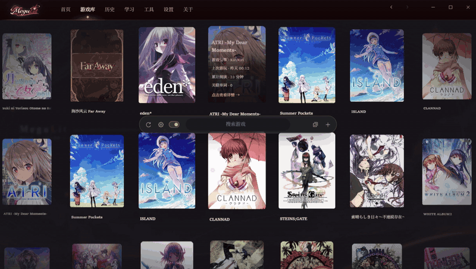
<br><sub>每打一个字母，不相关的封面就散开，剩下的排到中间</sub>
</div>

<br>

<table>
<tr>
<td width="50%">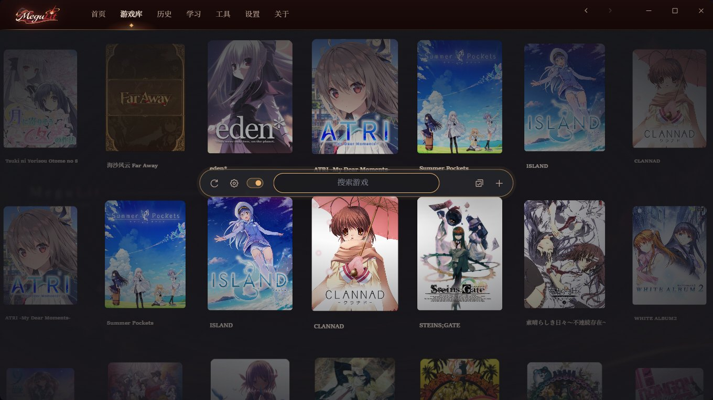</td>
<td width="50%">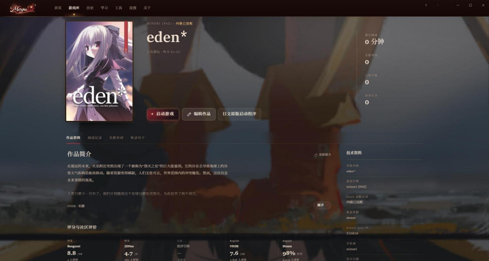</td>
</tr>
<tr>
<td><sub><b>游戏库</b> · 扫描文件夹和 Steam，系列作品自动归到一起</sub></td>
<td><sub><b>作品详情</b> · 简介、各站评分、阅读记录、关联单词和收藏的句子</sub></td>
</tr>
</table>

1. 第一次打开时选好放游戏的文件夹，MeguLit 会自动找出日文原版 EXE
2. 点封面进入作品详情，点「启动游戏」。需要转区的游戏可以单独开 Locale Emulator
3. 游戏启动后阅读层自动接上，按 <kbd>Alt</kbd> + <kbd>T</kbd> 呼出菜单

### 自动更新

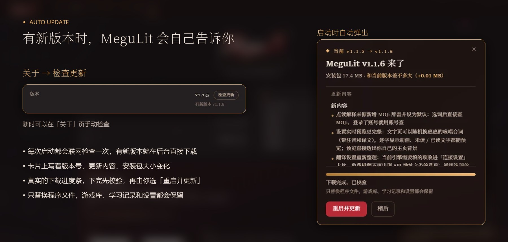

- 每次启动都会联网检查一次新版本，有的话直接在后台下载
- 卡片上写着版本号、更新内容，以及安装包比现在大还是小多少
- 下载有真实进度条，下完先校验，再由你选「重启并更新」或「稍后」
- 也可以随时到「关于」页点「检查更新」手动检查
- 只替换程序文件，游戏库、学习记录和设置都会保留

### 阅读层

浮在游戏上面，不抢焦点，点它也不会让剧情往下走

- **点一下**查单词，**拖一段**查短语，离线词典
- 注音优先用游戏自带的 ruby，没有再用词典和上下文
- 翻译支持 DeepL、Bing、Google、Gemini、DeepSeek、Sakura、Ollama 和 OpenAI 兼容接口，密钥加密存在本地
- 选中词或整句，让 AI 讲语法和语境
- 每部作品单独记字体、颜色和位置

### 历史

<table>
<tr>
<td width="50%">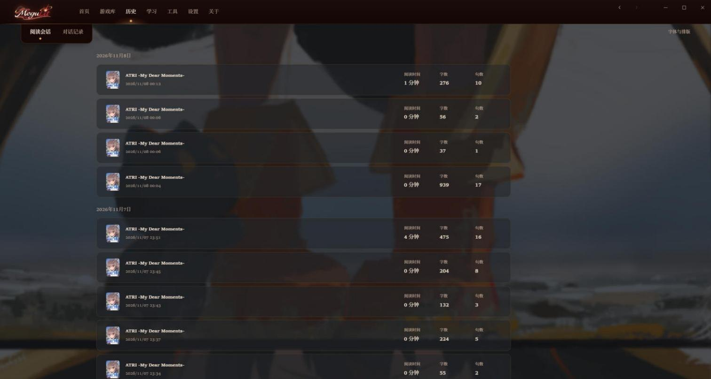</td>
<td width="50%">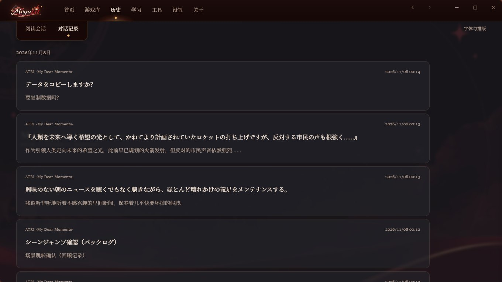</td>
</tr>
<tr>
<td><sub><b>阅读会话</b> · 每次玩了多久、读了多少字</sub></td>
<td><sub><b>对话记录</b> · 读过的每一句原文和译文</sub></td>
</tr>
</table>

### 学习

<table>
<tr>
<td width="50%">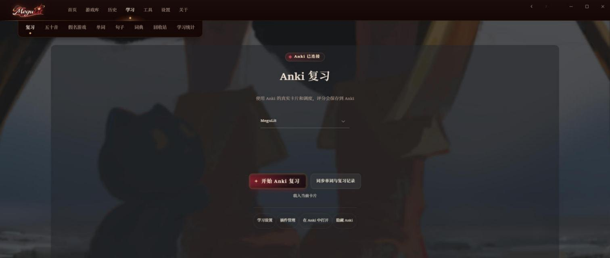</td>
<td width="50%">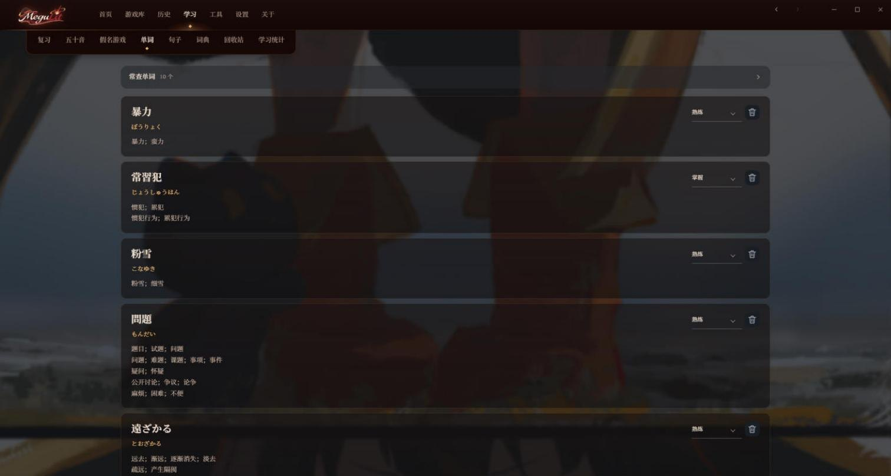</td>
</tr>
<tr>
<td><sub><b>Anki 复习</b> · 直接用 Anki 的卡片和调度，评分写回 Anki</sub></td>
<td><sub><b>单词本</b> · 查过的词、读音、释义和掌握程度</sub></td>
</tr>
</table>

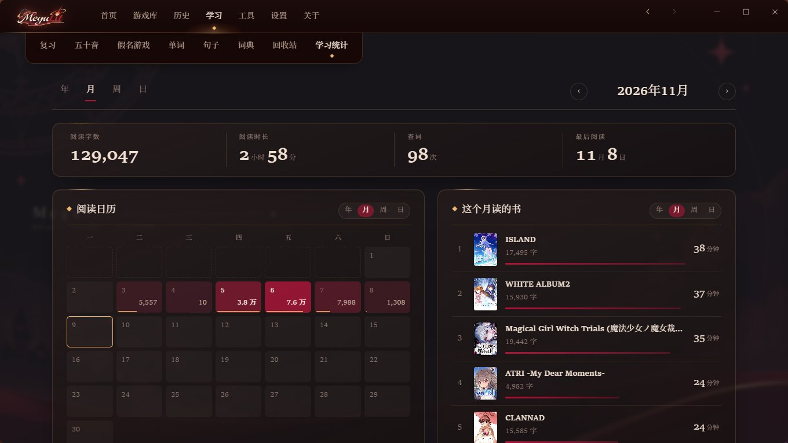

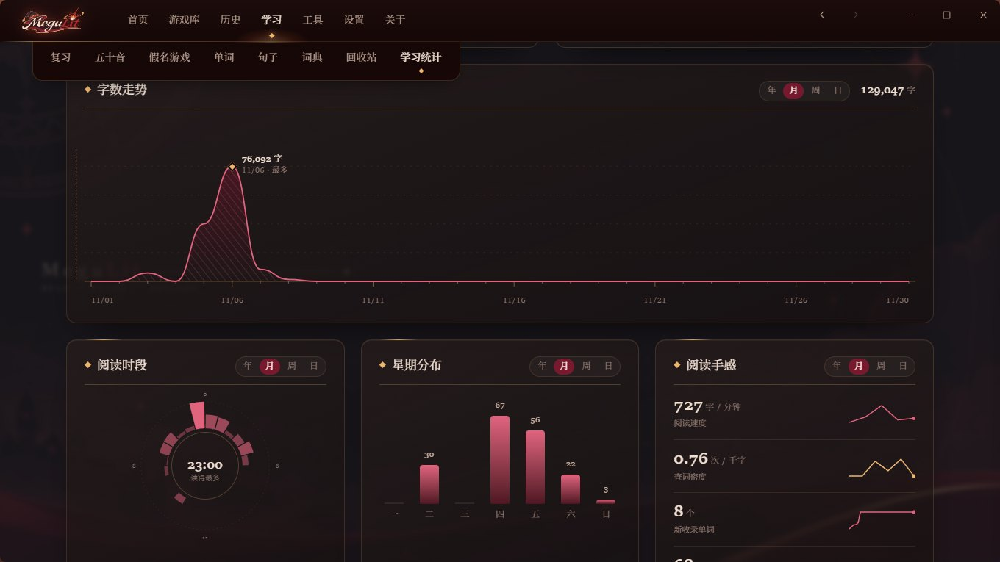

<p align="center"><sub><b>学习统计</b> · 阅读字数、时长、查词、日历、每部作品的阅读量、字数走势、阅读时段和星期分布</sub></p>

<table>
<tr>
<td width="50%">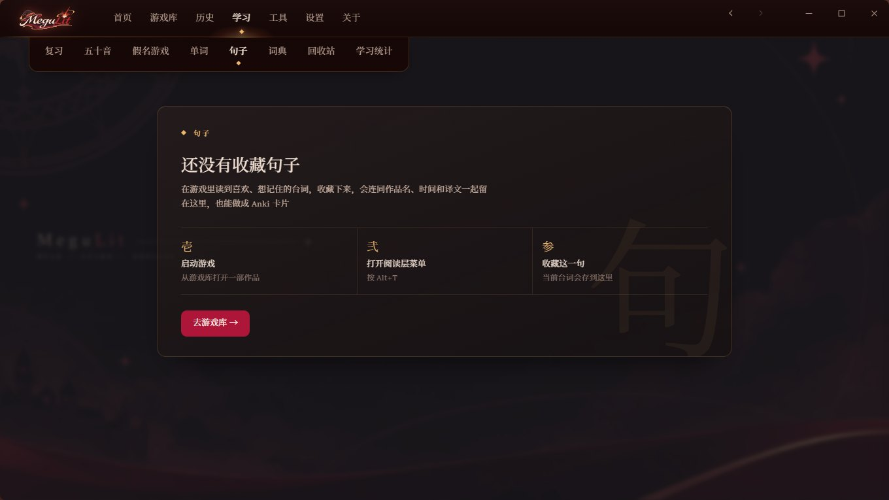</td>
<td width="50%"></td>
</tr>
<tr>
<td><sub><b>空页面</b> · 告诉你这里会出现什么、怎么让它出现</sub></td>
<td><sub><b>工具</b> · 日文原版恢复、修复内嵌替换</sub></td>
</tr>
</table>

- 在阅读层查词时点「制卡」，会带上游戏截图和原声；没配音的旁白用本地 TTS 补
- Anki 需要自己安装 Anki 和 AnkiConnect，MeguLit 可以一键装好 AnkiConnect

<br>

<a id="zh-kana"></a>

## 五十音

给零基础的人：先认得每一个假名，再到游戏里把它读出来

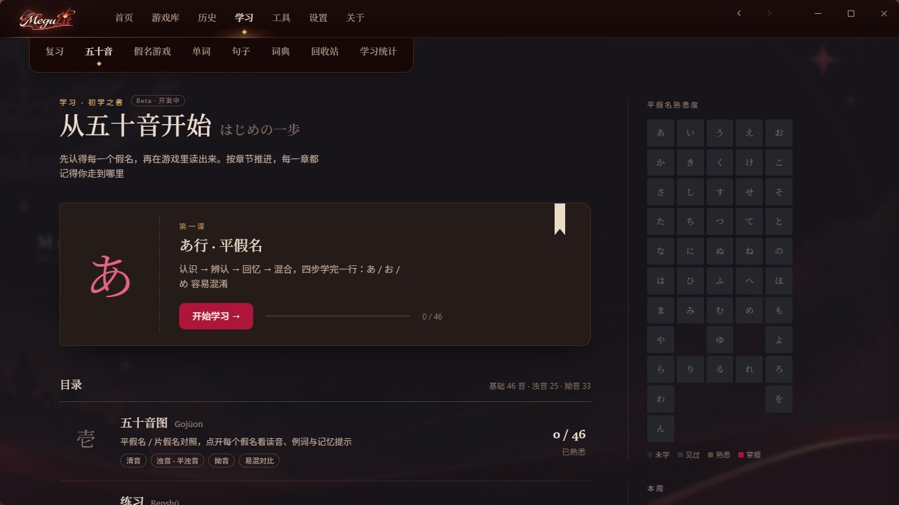

**学习 → 五十音 → 开始学习**。主页记住你学到哪一课，右边是平假名熟悉度

<table>
<tr>
<td width="50%">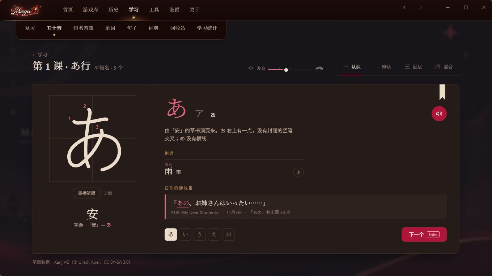</td>
<td width="50%">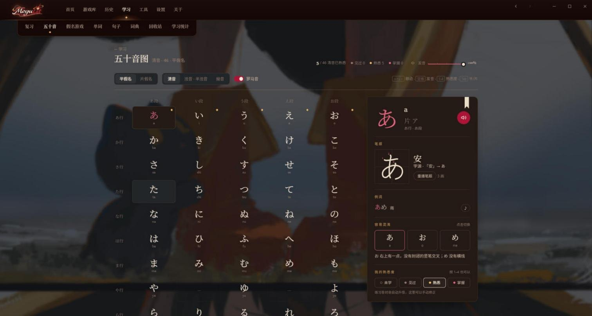</td>
</tr>
<tr>
<td><sub><b>一课四步</b> · 认识 → 辨认 → 回忆 → 混合。笔顺、字源、例词，还有<b>你自己玩过的游戏里</b>含这个假名的台词</sub></td>
<td><sub><b>五十音图</b> · 平 / 片假名，清音、浊音、拗音；点格子看笔顺、发音要点和易混字</sub></td>
</tr>
<tr>
<td>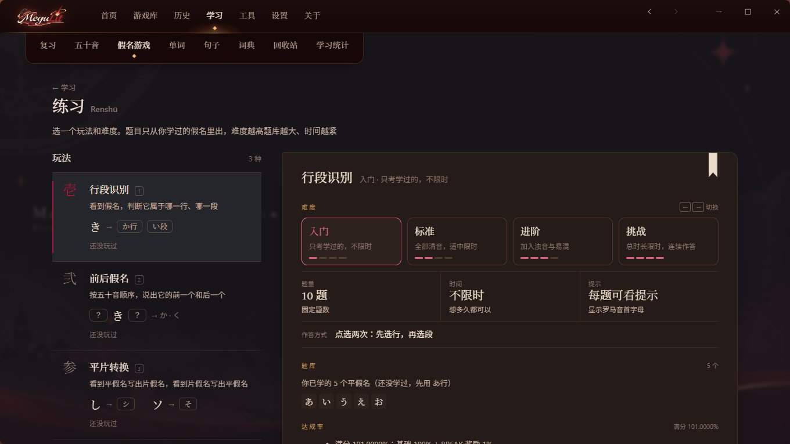</td>
<td>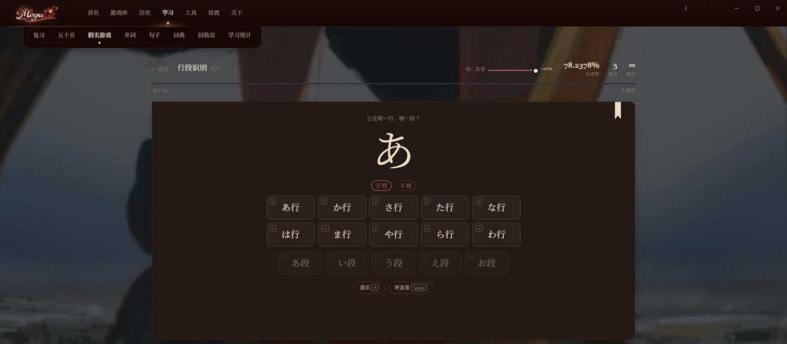</td>
</tr>
<tr>
<td><sub><b>假名游戏</b> · 三种玩法、四档难度，规则都写在面板上</sub></td>
<td><sub><b>行段识别</b> · 先按辅音字母选行，再按元音选段</sub></td>
</tr>
<tr>
<td>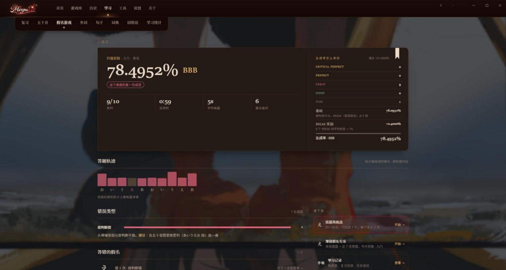</td>
<td>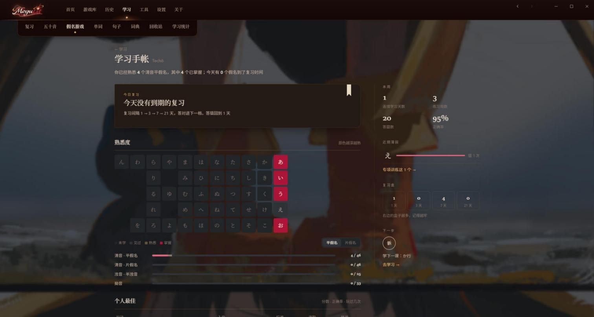</td>
</tr>
<tr>
<td><sub><b>结算</b> · 达成率、判定、答题轨迹和错题分析，一键错题再挑战</sub></td>
<td><sub><b>学习手帐</b> · 熟悉度、到期复习（1 → 3 → 7 → 21 天）、个人最佳</sub></td>
</tr>
</table>

<details>
<summary><b>玩法、难度和评分规则</b></summary>

<br>

| 玩法 | 怎么玩 |
|---|---|
| 行段识别 | 看到「き」，答出 か行 · い段。键盘先按 <kbd>k</kbd> 再按 <kbd>i</kbd> |
| 前后假名 | 按 あいうえお…わをん 的顺序说出前一个和后一个，空位直接跳过 |
| 平片转换 | 看平假名写片假名，反过来也一样。可以用日语输入法（<kbd>F7</kbd> / <kbd>F6</kbd>），也可以按 <kbd>K</kbd> 打开屏幕假名键盘 |

| 难度 | 规则 |
|---|---|
| 入门 | 只考学过的假名，不限时，每题可看提示 |
| 标准 | 全部清音，每题限时，整局 3 次提示 |
| 进阶 | 加入浊音、拗音和易混字，限时更短 |
| 挑战 | 总计 90 秒，错 3 次结束，没有提示 |

- 每道题是一个音符：普通假名算 TAP，最容易认错的几组（シ / ツ、ソ / ン、ぬ / め、ね / れ / わ…）算 **BREAK**，分量是 5 倍
- 答得快是 CRITICAL PERFECT，稍慢 PERFECT，再慢 GREAT；用了提示算 GOOD，答错或超时算 MISS
- 基础 100% 加 BREAK 奖励最多 1%，**满分 101.0000%**，评级从 SSS+ 到 D

快捷键：<kbd>Enter</kbd> 下一个，<kbd>Space</kbd> 发音，<kbd>←</kbd> <kbd>→</kbd> 切换假名，答题时按 <kbd>1</kbd>–<kbd>4</kbd>

</details>

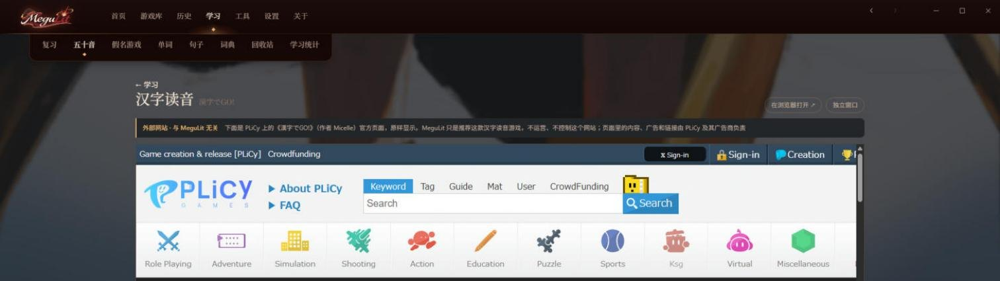

<sub><b>汉字读音</b> · 学完假名可以玩《漢字でGO!》。MeguLit 只是在窗口里原样打开 PLiCy 上的官方页面（作者 Micelle，含广告），<b>不是 MeguLit 的一部分</b>；不想在 MeguLit 里玩，可以点「在浏览器打开」</sub>

<br><br>

<a id="zh-install"></a>

## 安装

> [!IMPORTANT]
> **游戏剧情必须是日文原文**。MeguLit 读的是游戏正在显示的台词，剧情被汉化后读到的就不是日文。只汉化了菜单、剧情仍是日文的游戏不受影响；汉化版可以先试试「工具 → 日文原版恢复」

1. 去 [Releases](https://github.com/ilynthn/MeguLit/releases/latest) 下载 `MeguLit-v1.3.0-win-x64.zip`（约 18 MB），解压后运行 `MeguLit.exe`
2. 第一次启动会弹出安装窗口，二选一
   - **完整版**：下载约 565 MB，一次装齐注音词典和 AivisSpeech 语音引擎，需要约 1.8 GB 空间（推荐）
   - **精简版**：下载约 107 MB，能用阅读层、翻译和查词，其余组件以后在设置里补装
3. 选好放游戏的文件夹，等游戏库扫描完
4. 点一部作品 →「启动游戏」，**用窗口模式玩**
5. 零基础的话，先去 学习 → 五十音

装过旧版：用新文件覆盖旧的 MeguLit 文件夹即可，组件和数据都保留

需要 Windows 10 / 11 x64 和 Microsoft Edge WebView2 Runtime。本地翻译模型比较大，不在安装包里，需要时在设置里下载

<br>

<a id="faq"></a>

## 常见问题

<details open>
<summary><b>全屏玩的时候翻译显示不全，或者文字跑到了桌面上</b></summary>

<br>

请把游戏切到**窗口模式**。全屏（独占全屏）现在有 bug：游戏会盖住其他所有窗口，阅读层没法稳定地画在游戏上面。窗口模式下效果最好，窗口拉大一点也没关系

</details>

<details>
<summary><b>点「启动游戏」提示「无法检查游戏是否已运行」</b></summary>

<br>

v1.1.0 已经修复。旧版本在部分电脑上（多半是杀毒软件拦了进程查询）会这样，更新就好

</details>

<details>
<summary><b>读到的是乱码，或者根本不是日文</b></summary>

<br>

剧情必须是日文原文。汉化版先试试「工具 → 日文原版恢复」

</details>

<details>
<summary><b>更新会不会弄丢我的数据</b></summary>

<br>

不会。自动更新只替换程序文件，`data`、`logs`、`cache`、`runtime`、`models` 都不碰。旧的 `MeguLit.exe` 还会留一份 `MeguLit.rollback-update.exe`

</details>

<details>
<summary><b>Anki 连不上</b></summary>

<br>

先打开 Anki，并装好 AnkiConnect（MeguLit 里可以一键安装）。端口 8765 被别的程序占用也会连不上

</details>

<details>
<summary><b>某个游戏读不到文字</b></summary>

<br>

不同引擎差别很大。请在 [Issues](https://github.com/ilynthn/MeguLit/issues) 留下游戏名，最好附上 MeguLit 的 `logs` 文件夹

</details>

<br>

## 现在能做什么

| 功能 | 状态 | 说明 |
|---|:---:|---|
| 抓取游戏文本 | ✅ | 基于 LunaHook，自动挑文本流，不对可以手动换 |
| 阅读层 · 注音 · 点读 | ✅ | 游戏自带 ruby 优先；点读不推进剧情 |
| 实时翻译 · AI 讲解 | ✅ | 多家翻译和大模型接口，密钥加密存在本地 |
| 生词本 · Anki | ✅ | 单词、例句、回收站；制卡带截图和原声 |
| 游戏库 · 启动器 | ✅ | 扫文件夹和 Steam，自动认日文原版 EXE |
| 学习统计 | ✅ | 年 / 月 / 周 / 日，每块单独切换 |
| 自动更新 · 备份恢复 | ✅ | 只换程序文件；备份恢复失败自动回滚 |
| 五十音 | Beta | 25 课、五十音图、三个小游戏、学习手帐 |
| 内嵌替换 | 实验中 | 部分引擎会报错甚至闪退 |
| 本地模型与 TTS | 实验中 | 需要本地显卡环境 |

## 接下来

- [ ] **第四个假名小游戏：太鼓风节奏游戏**，随机用你装的 Galgame 的 BGM，检测 BPM 和鼓点，跟着节奏认假名
- [ ] 五十音学习的英文、日文界面
- [ ] 按引擎判断能不能安全内嵌；区分「重绘」和「真的又说了一遍」
- [ ] 保住游戏原生 LOG 里的原文；开场、章节标题、独立字幕
- [ ] 联网排行榜：阅读量、生词数、连续打卡天数
- [ ] 更多学习语言，以及 Galgame 以外的游戏

## 从源码构建

```powershell
.\Build.ps1 -Check
```

需要 Rust（Tauri）、Node.js 和 .NET Framework 的 C# 编译器

## 致谢

[LunaHook](https://github.com/HIllya51/LunaHook)（文本 Hook）· [JMdict / EDRDG](https://www.edrdg.org/jmdict/j_jmdict.html)（词典）· [SudachiDict](https://github.com/WorksApplications/SudachiDict)（分词）· [KanjiVG](https://kanjivg.tagaini.net/)（© Ulrich Apel，CC BY-SA 3.0，笔顺）· [AivisSpeech](https://aivis-project.com/)（语音）· [Tauri](https://tauri.app/) · [Anki](https://apps.ankiweb.net/) & AnkiConnect · [Tomoyo](https://github.com/46daishi/tomoyo)（最早的灵感）

推荐游戏：[漢字でGO!](https://plicy.net/GamePlay/155561)（Micelle · PLiCy），只是推荐，与 MeguLit 无关

GPL-3.0-or-later，见 [LICENSE](LICENSE)；第三方组件按各自许可证，见 [THIRD-PARTY.md](THIRD-PARTY.md)

<br>

---

<a id="en"></a>

# English

**A small grimoire for reading Japanese inside visual novels.** Original text, translation, furigana, lookups, AI explanations, a word list and Anki review all happen next to the game, with no alt-tabbing.

### New in v1.2

| | |
|---|---|
| **Zero-latency translation** | A translation patch you already have becomes the translation: the Japanese original with the group's wording, no waiting. Tested on KiriKiri, BGI, Siglus, YU-RIS, Artemis and Ren'Py games such as euphoria, WHITE ALBUM2, Tsukihime and Senren＊Banka; untranslated lines are machine-translated ahead of time |
| **Restore Japanese** | Switch Steam Chinese / English releases back to Japanese, or pick a Japanese release as an archive, folder or even a disc image; MeguLit swaps the files, backs everything up and undoes in one click |
| **In-game replacement for more games** | Generic YU-RIS embedding, 64-bit KiriKiri, and full-page text in Witch on the Holy Night aligned line by line |
| **Less fiddling** | The scan area follows the window and full screen · one click re-picks a garbled text stream · Chinese builds tell you how to switch to Japanese |
| **Community reviews** | Steam reviews by language region; long reviews expand inside MeguLit |

The updater in v1.1.0 and v1.1.1 reopens the old version, so download v1.1.2 by hand once; from v1.1.2 on it updates itself.

From then on MeguLit checks for a new release on every start and downloads it in the background (or check by hand under About → Check for updates). Only program files are replaced.

<table>
<tr>
<td width="50%"></td>
<td width="50%"></td>
</tr>
<tr>
<td></td>
<td></td>
</tr>
</table>

### Install

1. Download `MeguLit-v1.3.0-win-x64.zip` (about 18 MB) from [Releases](https://github.com/ilynthn/MeguLit/releases/latest), unzip it and run `MeguLit.exe`
2. Pick **Full** (about 565 MB, furigana dictionaries and the AivisSpeech voice engine) or **Lite** (about 107 MB)
3. Choose your game folder, pick a game and press *Launch*. Press <kbd>Alt</kbd> + <kbd>T</kbd> for the overlay menu

The game's story text must be the original Japanese. Needs Windows 10 / 11 x64 and the WebView2 Runtime.

### FAQ

- **Translations cut off, or text on the desktop in fullscreen?** Play in **windowed mode**. Exclusive fullscreen has a bug where the overlay cannot stay on top of the game.
- **"Could not check whether the game was running"?** Fixed in v1.1.0.
- **Does an update delete my data?** No. Only program files are replaced.

GPL-3.0-or-later · [LICENSE](LICENSE) · [THIRD-PARTY.md](THIRD-PARTY.md)

<br>

---

<a id="ja"></a>

# 日本語

**ギャルゲーの中で日本語を読むための小さな魔導書。**原文、翻訳、ふりがな、辞書、AI 解説、単語帳、Anki 復習を、ゲームの横で全部済ませられます

### v1.2 の新機能

| | |
|---|---|
| **ゼロ遅延翻訳** | 手元の中国語パッチをそのまま訳文に。日本語原文と翻訳グループの訳が待ち時間なしで並びます。KiriKiri、BGI、Siglus、YU-RIS、Artemis、Ren'Py など、euphoria、WHITE ALBUM2、月姫、千恋＊万花で確認済み。訳のない文は先に機械翻訳 |
| **日本語原版に戻す** | Steam の中国語 / 英語版を日本語に戻せます。日本語版の圧縮ファイル、フォルダ、ディスクイメージからも取り込み可能。すべてバックアップし、ワンクリックで元に戻せます |
| **埋め込み対応の拡大** | YU-RIS の汎用埋め込み、64 bit KiriKiri、全画面テキストの魔法使いの夜を行ごとに原文へ合わせて表示 |
| **手間いらず** | スキャン範囲がウィンドウと全画面に自動追従 · 文字化けしたらワンクリックでストリーム選び直し · 中国語版なら日本語への切り替え方を案内 |
| **コミュニティレビュー** | Steam レビューを言語地域別に表示、長文はアプリ内で全文展開 |

v1.1.0 と v1.1.1 の自動更新には不具合があるため、今回だけ手動で v1.1.2 をダウンロードしてください。v1.1.2 からは自動で更新されます

<table>
<tr>
<td width="50%"></td>
<td width="50%"></td>
</tr>
</table>

### インストール

1. [Releases](https://github.com/ilynthn/MeguLit/releases/latest) から `MeguLit-v1.3.0-win-x64.zip`（約 18 MB）をダウンロードして展開し、`MeguLit.exe` を起動
2. 初回セットアップで **完全版**（約 565 MB）か **軽量版**（約 107 MB）を選択
3. ゲームフォルダを選び、作品を選んで「ゲーム起動」。<kbd>Alt</kbd> + <kbd>T</kbd> でメニュー

シナリオ本文は日本語原文である必要があります。Windows 10 / 11 x64 と WebView2 Runtime が必要です

### よくある質問

- **フルスクリーンで翻訳が欠ける・文字がデスクトップに出る**：**ウィンドウモード**で遊んでください。排他フルスクリーンには不具合があります
- **「ゲームが起動中か確認できません」**：v1.1.0 で修正済みです
- **アップデートでデータは消える？**：消えません。プログラムだけを置き換えます

GPL-3.0-or-later · [LICENSE](LICENSE) · [THIRD-PARTY.md](THIRD-PARTY.md)

<br>

---

<a id="support"></a>

<div align="center">

# ♡ Support MeguLit

和 Bug 魔王军的战斗还在继续，冒险经费倒是快见底了……(›´ω`‹ )

如果 MeguLit 为你的日语学习带来了一点帮助，欢迎赞助一点厄里斯，支持项目继续开发！

**每一份支持，都能让这场冒险走得更远 ヾ(≧▽≦*)o**

<br>

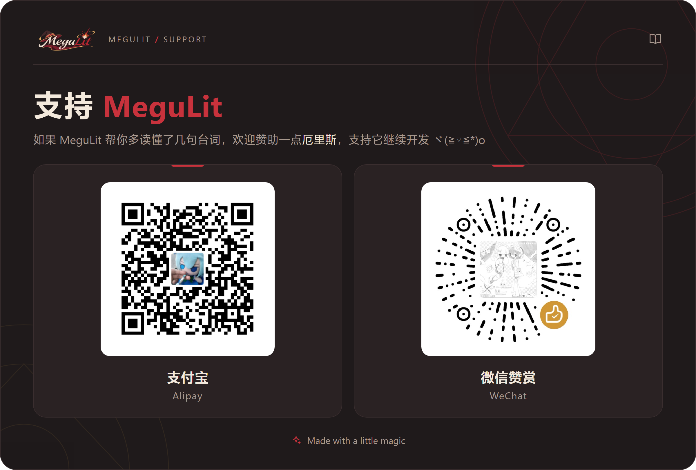

<br><br>

MeguLit is free, open source, and built in my spare time.<br>
If it helped you read a few more lines in Japanese, a small sponsorship keeps the updates coming.

[](https://github.com/sponsors/ilynthn)

<sub>Every Eris counts ♡</sub>

</div>

---

<div align="center">
<sub>Made by <a href="https://github.com/ilynthn">ilynthn</a> with love, caffeine, and a concerning number of bugs ✦</sub><br>
<sub>Free code signing provided by <a href="https://about.signpath.io">SignPath.io</a>, certificate by <a href="https://signpath.org">SignPath Foundation</a> · <a href="docs/CODE-SIGNING.md">Code signing policy</a></sub>
</div>
