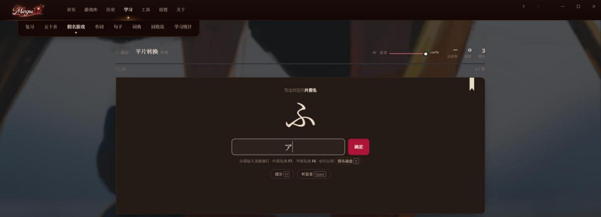

<div align="center">


**Read the game, keep the game.**
Windows 上的 Galgame 阅读与日语学习工具

[](LICENSE)


[](https://github.com/sponsors/ilynthn)

[简体中文](#zh) · [English](#en) · [日本語](#ja) · [♡ 赞赏 / Support](#support)


</div>

> [!WARNING]
> 还在积极开发中，功能、数据格式、界面随时可能变
>
> Still in active development. Things may change.
>
> 開発中です。機能や画面は変わることがあります

---

<a id="zh"></a>

## 简体中文

- [为什么做这个](#zh-why)
- [v1.0.5 新内容](#zh-new)
- [功能预览与用法](#zh-tour)
- [五十音学习（新）](#zh-kana)
- [安装与快速上手](#zh-install)
- [现在能做什么](#zh-status)
- [接下来](#zh-roadmap)
- [致谢与许可](#zh-thanks)

<a id="zh-why"></a>

### 为什么做这个

我想靠 Galgame 学日语，结果发现现有的工具都在逼我二选一：要么老老实实玩原版，遇到不认识的词就切出去查；要么在旁边外挂一个窗口，游戏里的原文照样显示，两份字摆在眼前，看着很难受

两个我都不想要，所以干脆自己做了一个。基本是和 AI 一起 vibe coding 出来的，每天自己在用，哪里难受就改哪里

MeguLit 想做的事情就一句话：**游戏还是那个游戏，只是你能读懂了**。原文、翻译、注音、查词、AI 讲解、生词本、Anki 复习，都在游戏旁边完成，不用来回切窗口

界面有简体中文、English、日本語三种。学日语的中文/英文用户是主要对象，反过来用日语学中文或英文也可以

<a id="zh-new"></a>

### v1.0.5 新内容

- **五十音学习（Beta）**：「学习」里新增「五十音」和「假名游戏」两个标签，给完全没学过日语的人从零开始用
  - 25 课：平假名、片假名、浊音，每课一行，认识 → 辨认 → 回忆 → 混合四步
  - 笔顺动画（KanjiVG 数据）、字源、例词、易混对比
  - **例句来自你自己玩过的游戏**：学 あ行 时，会从你的阅读记录里找出含这个假名的台词
  - 发音走 MeguLit 的 AivisSpeech，用词典读音和音调，默认「まお · おちつき」风格，有单独的音量
- **三个假名小游戏**：行段识别、前后假名、平片转换，四档难度，支持日语输入法和屏幕假名键盘
- **达成率评分**：满分 101.0000%，分 CRITICAL PERFECT / PERFECT / GREAT / GOOD / MISS 五种判定和 SSS+ 到 D 的评级；结算页逐项列出分数来源和错题分析
- **学习手帐**：熟悉度、到期复习（1 → 3 → 7 → 21 天）、个人最佳、练习记录
- **汉字读音**：在 MeguLit 里打开《漢字でGO!》官方页面（外部网站，与 MeguLit 无关）
- 学习进度存在本地 `data/kana-progress.json`，重启后恢复

<a id="zh-tour"></a>

### 功能预览与用法

#### 首页与游戏库

<table>
<tr>
<td width="50%"></td>
<td width="50%"></td>
</tr>
<tr>
<td>首页：上次读到哪、最近游玩、今天读了多少</td>
<td>游戏库：扫描文件夹和 Steam，系列作品会归到一起</td>
</tr>
</table>

1. 第一次打开时选择放游戏的文件夹，MeguLit 会自动找出日文原版 EXE
2. 点封面进入作品详情，点「启动游戏」。需要转区的游戏可以在详情里单独打开 Locale Emulator
3. 游戏启动后阅读层会自动接上；按 **Alt+T** 呼出阅读层菜单


作品详情：简介、Bangumi / 2DFan / VNDB / Steam 评分、阅读记录、关联单词和收录的句子

#### 阅读层：注音、点读、翻译

阅读层浮在游戏上面，不抢焦点，也不会让剧情往下走

- **点一下** 查单词，**拖一段** 查短语，离线词典
- 注音优先用游戏自带的 ruby，没有时再用词典和上下文
- 翻译支持 DeepL、Bing、Google、Gemini、DeepSeek、Sakura、Ollama 和 OpenAI 兼容接口，密钥加密存在本地
- 选中词或整句可以让 AI 讲语法和语境
- 每部作品单独记字体、颜色、位置，可以对着游戏画面调

#### 历史

<table>
<tr>
<td width="50%"></td>
<td width="50%"></td>
</tr>
<tr>
<td>阅读会话：每次玩了多久、读了多少字</td>
<td>对话记录：读过的每一句原文和译文</td>
</tr>
</table>

#### 学习：Anki、单词、统计

<table>
<tr>
<td width="50%"></td>
<td width="50%"></td>
</tr>
<tr>
<td>Anki 复习：直接用 Anki 的卡片和调度，评分写回 Anki</td>
<td>单词本：查过的词、读音、释义和掌握程度</td>
</tr>
</table>


学习统计：按年 / 月 / 周 / 日看阅读字数、时长、查词次数和每部作品的阅读量

- 在阅读层查词时点「制卡」，会带上游戏截图和原声（没配音的旁白用本地 TTS 补）
- Anki 需要自己安装 Anki 和 AnkiConnect，MeguLit 可以一键装好 AnkiConnect

#### 工具


- **日文原版恢复（实验性）**：游戏自带日文数据时，把显示语言切回日文
- **修复内嵌替换（研究中）**：诊断内嵌为什么变成只读，能修就修，修不了说明原因

<a id="zh-kana"></a>

### 五十音学习（新）

给完全零基础的人：先认得每一个假名，再在游戏里读出来


**怎么开始**：学习 → 五十音 → 「开始学习」。主页会记住你学到哪一课，右边是平假名熟悉度、本周数据和下一步建议

#### 一课四步


1. **认识**：看笔顺动画、字源（例如「加 → か」）、例词，点喇叭听发音
2. **辨认**：看假名选读音，干扰项会故意放形近的字
3. **回忆**：看罗马音或听发音，选出假名
4. **混合**：本课和学过的假名打乱出题，答错的稍后会再出现

「在你的游戏里」会从你自己的阅读记录里找含这个假名的台词，例如上图的 か 来自 ISLAND。标题行右边的「发音」细尺单独调学习发音的音量，不影响游戏朗读

快捷键：Enter 下一个，空格发音，← → 切换假名，答题时按 1–4

#### 五十音图


- 平假名 / 片假名，清音 / 浊音·半浊音 / 拗音，罗马音可以隐藏自测
- や行、わ行的空位和「ん」按真实位置排，不硬填
- 点格子看详情：笔顺、字源、发音要点、例词、易混对比；按 1–4 手动标熟悉度
- 方向键移动，空格发音，Tab 切换平 / 片

#### 假名游戏

<table>
<tr>
<td width="50%"></td>
<td width="50%"></td>
</tr>
<tr>
<td>选玩法和难度，题量、限时、提示、题库都写在面板上</td>
<td>行段识别：先按辅音字母选行，再按元音选段</td>
</tr>
</table>

| 玩法 | 怎么玩 |
|---|---|
| 行段识别 | 看到「き」，答出 か行 · い段。键盘先按辅音字母（k）再按元音（i） |
| 前后假名 | 按 あいうえお…わをん 的顺序说出前一个和后一个，空位直接跳过 |
| 平片转换 | 看到平假名写片假名，反过来也一样。可以用日语输入法（F7 / F6 转换），也可以按 K 打开屏幕假名键盘 |

| 难度 | 规则 |
|---|---|
| 入门 | 只考学过的假名，不限时，每题可看提示 |
| 标准 | 全部清音，每题限时，整局 3 次提示 |
| 进阶 | 加入浊音、拗音和易混字，限时更短 |
| 挑战 | 总计 90 秒，错 3 次结束，没有提示 |



#### 达成率与结算


- 每道题是一个音符：普通假名算 TAP，最容易认错的几组（シ / ツ、ソ / ン、ぬ / め、ね / れ / わ…）算 **BREAK**，分量是 5 倍
- 判定：答得快是 CRITICAL PERFECT，稍慢 PERFECT，再慢 GREAT；用了提示算 GOOD，答错或超时算 MISS
- 基础 100% 加 BREAK 奖励最多 1%，**满分 101.0000%**；评级从 SSS+（100.5% 以上）到 D
- 结算页列出每种判定的次数、答题轨迹、错误类型和建议，可以一键「错题再挑战」或「薄弱假名专项」

#### 学习手帐


- 熟悉度按竖排五十音显示，颜色越深越熟
- 复习间隔 1 → 3 → 7 → 21 天，答对进下一档，答错回到 1 天；到期的假名会出现在「今日复习」
- 个人最佳、练习记录、近期薄弱的假名和下一步建议

#### 汉字读音


学完假名后可以玩《漢字でGO!》练汉字读音。MeguLit 只是在窗口里原样打开 PLiCy 上的官方页面（作者 Micelle，含广告），**不是 MeguLit 的一部分**，也不复制任何游戏内容；不想在 MeguLit 里玩，可以点「在浏览器打开」

<a id="zh-install"></a>

### 安装与快速上手

> [!WARNING]
> **游戏剧情必须是日文原文。** MeguLit 读取的是游戏正在显示的台词：如果剧情文本被汉化或翻译成其他语言，读到的就不是日文，注音、点读、翻译都会变成乱码或无法使用。只汉化了菜单、按钮等界面、剧情仍是日文的游戏不受影响。中文版游戏可以先试试「工具 → 日文原版恢复（实验性）」

1. 去 [Releases](https://github.com/ilynthn/MeguLit/releases/latest) 下载 `MeguLit-v1.0.5-win-x64.zip`（约 17 MB），解压后运行 `MeguLit.exe`
2. 第一次启动会弹出安装窗口，二选一：
   - **完整版**：下载约 565 MB，一次装齐全部组件（注音分词词典、AivisSpeech 语音引擎），需要预留约 1.8 GB 磁盘。推荐
   - **精简版**：下载约 107 MB，能用阅读层、翻译和查词，其余组件以后可以在设置里补装
3. 选择放游戏的文件夹，等游戏库扫描完
4. 在游戏库点一部作品 → 「启动游戏」，阅读层会自动接上
5. 零基础的话，先去 学习 → 五十音 学完平假名再开始读

已经装过旧版：直接用新文件覆盖旧的 MeguLit 文件夹，组件和数据都会保留

需要 Windows 10/11 x64 和 Microsoft Edge WebView2 Runtime。本地翻译模型比较大，不在安装包里，需要的话在设置里按需下载

<a id="zh-status"></a>

### 现在能做什么

> 写「能用」的，是我真的拿游戏玩过的；「实验中」是代码接上了，但只在部分引擎上跑通，或者只过了自动测试

| 功能 | 状态 | 说明 |
|---|---|---|
| 抓取游戏文本 | 能用 | 基于 LunaHook，自动挑文本流，不对可以手动换 |
| 阅读层 | 能用 | Alt+T 呼出菜单；每部作品单独记样式 |
| 打字机效果 | 能用 | 逐字出现，等待符跟着文字走 |
| 假名注音 | 能用 | 游戏自带 ruby 优先，没有再用词典和上下文判断 |
| 点读查词 | 能用 | 点一下查单词，拖一段查短语，离线词典；点读不会让剧情往下走 |
| 实时翻译 / AI 讲解 | 能用 | 多家翻译和大模型接口，密钥加密存在本地 |
| 生词本 / Anki | 能用 | 单词、例句、回收站；AnkiConnect 制卡，带截图和原声 |
| 游戏库 / 启动器 | 能用 | 扫文件夹和 Steam，自动认日文原版 EXE，可按作品开 Locale Emulator |
| 备份恢复 | 能用 | 一键完整备份，恢复失败自动回滚 |
| 五十音学习 | Beta | 25 课、五十音图、三个小游戏、达成率、学习手帐 |
| 内嵌替换 | 实验中 | 把游戏里的原文直接换掉。部分引擎会报错甚至闪退，不建议开 |
| 本地模型与 TTS | 实验中 | 需要本地显卡环境，测得还不够 |

### 难在哪

做久了才发现，麻烦的不是功能本身，而是每个引擎都不按常理出牌：

- **能读不能写**：很多引擎只给只读的文本流。能写的那条，又常常和脚本、资源名、历史记录共用一个函数，一写就崩
- **只能做通用规则**：给单个游戏打补丁很快，可游戏太多了，修复必须对一类引擎都成立
- **重复和漏句**：同一句被重绘好几次、多条候选流、注音排版，都会造成重复或者漏掉。可有些台词就是故意重复的，不能一刀切去重
- **点一下就跳剧情**：不少游戏直接轮询鼠标状态，你点的是阅读层，游戏也以为你点了它
- **注音排版**：不能撑开行距，要对齐汉字，还要扛住描边、混排、逐字显示和高 DPI

<a id="zh-roadmap"></a>

### 接下来

- [x] 主流引擎上点读、拖选不推进剧情（实机验过）
- [x] 注音偏移和行距彻底分开
- [x] 主界面设全局文字样式，新游戏自动继承
- [x] 五十音学习：课程、五十音图、三个小游戏、学习手帐
- [ ] **第四个假名小游戏：类似太鼓的节奏游戏**，随机用你装的 Galgame 的 BGM，自动检测 BPM 和鼓点，跟着节奏认假名
- [ ] 五十音学习的英文、日文界面
- [ ] 把脚本控制串、名字变量挡在阅读和学习数据之外
- [ ] 按引擎能力判断能不能安全内嵌，找脚本执行之后的绘制入口
- [ ] 靠引擎事件或行 ID 区分「重绘」和「真的又说了一遍」
- [ ] 保住游戏原生 LOG 里的原文
- [ ] 开场、章节标题、独立字幕
- [ ] 联网排行榜：阅读量、生词数、连续打卡天数
- [ ] 更多学习语言，以及轻小说和 Galgame 以外的游戏

### 从源码构建

```powershell
.\Build.ps1 -Check
```

要准备 Rust（Tauri）、Node.js 和 .NET Framework 的 C# 编译器

<a id="zh-thanks"></a>

### 致谢

没有这些项目就没有 MeguLit：

- [LunaHook](https://github.com/HIllya51/LunaHook)：文本 Hook
- [JMdict](https://www.edrdg.org/jmdict/j_jmdict.html) / EDRDG：日语词典数据
- [SudachiDict](https://github.com/WorksApplications/SudachiDict)：分词词典
- [KanjiVG](https://kanjivg.tagaini.net/)（© Ulrich Apel，CC BY-SA 3.0）：假名笔顺数据
- [AivisSpeech](https://aivis-project.com/)：语音合成
- [Tauri](https://tauri.app/)：桌面宿主
- [Anki](https://apps.ankiweb.net/) 和 AnkiConnect
- [Tomoyo](https://github.com/46daishi/tomoyo)：最早的参考和灵感
- 推荐游戏：[漢字でGO!](https://plicy.net/GamePlay/155561)（Micelle · PLiCy）。只是推荐，与 MeguLit 无关

### 许可证

GPL-3.0-or-later，见 [LICENSE](LICENSE)。第三方组件按各自的许可证，见 [THIRD-PARTY.md](THIRD-PARTY.md)

---

<a id="en"></a>

## English

### Why this exists

I wanted to learn Japanese by playing visual novels, and every tool I tried made me pick one: play the original game and alt-tab to a dictionary every other line, or float a separate window next to it while the game keeps showing its own text underneath.

I didn't want either, so I built my own, mostly by vibe coding with AI. I use it every day and fix whatever annoys me. The idea fits in one line: **it's still the same game, you just get to understand it.**

The UI comes in Simplified Chinese, English and Japanese. The new kana course below is Chinese-only for now.

### New in v1.0.5

- **Kana course (beta)**: two new tabs under Learn, *Kana* and *Kana games*. 25 lessons (hiragana, katakana, voiced kana), stroke-order animation from KanjiVG, kana origins, example words, look-alike comparisons, and **example lines taken from games you've actually read**. Voice goes through MeguLit's AivisSpeech with dictionary readings and pitch accent, with its own volume.
- **Three kana games** (row/column, before/after, hiragana ↔ katakana) with four difficulty levels, Japanese IME input and an on-screen kana keyboard
- **Achievement scoring**: max 101.0000%, five judgments (CRITICAL PERFECT to MISS), ranks from SSS+ to D, and a results page that explains every point and every mistake
- **Study notebook**: familiarity map, spaced review (1 → 3 → 7 → 21 days), personal bests, practice log
- **Kanji reading**: opens the official *漢字でGO!* page (by Micelle, on PLiCy) inside MeguLit. It's an external site and not part of MeguLit.

### Tour

<table>
<tr>
<td width="50%"></td>
<td width="50%"></td>
</tr>
<tr>
<td>Library: folder and Steam scan, series grouping</td>
<td>Game page: synopsis, ratings, reading log, linked words</td>
</tr>
<tr>
<td></td>
<td></td>
</tr>
<tr>
<td>History: every line you read, with its translation</td>
<td>Statistics: characters, time and lookups per day and per game</td>
</tr>
<tr>
<td></td>
<td></td>
</tr>
<tr>
<td>Kana lesson: strokes, origin, example word, a line from your own games</td>
<td>Kana chart: details, look-alikes and familiarity per kana</td>
</tr>
<tr>
<td></td>
<td></td>
</tr>
<tr>
<td>Kana game: pick the row, then the column</td>
<td>Results: achievement, judgments and mistakes</td>
</tr>
</table>

**In the reader overlay** (over the game, Alt+T for the menu): click a word or drag across a phrase to look it up, furigana from in-game ruby first, live translation from many providers, AI explanations, one-click Anki cards with a screenshot and the original voice line. Clicks never advance the story.

### Install

> [!WARNING]
> **The game's story text must be the original Japanese.** A translated interface is fine as long as the dialogue itself is still Japanese. For a translated edition, try Tools → Restore Japanese (experimental) first.

1. Download `MeguLit-v1.0.5-win-x64.zip` (about 17 MB) from [Releases](https://github.com/ilynthn/MeguLit/releases/latest), unzip it and run `MeguLit.exe`. Upgrading: unzip over the old folder; components and data are kept.
2. Pick **Full** (about 565 MB, everything including furigana dictionaries and the AivisSpeech voice engine, about 1.8 GB on disk) or **Lite** (about 107 MB; add the rest later in Settings).
3. Choose your game folder, pick a game in the library and press *Launch*. The overlay attaches by itself.
4. New to Japanese? Start with Learn → Kana.

Needs Windows 10/11 x64 and the Microsoft Edge WebView2 Runtime. For the Anki features, install Anki and AnkiConnect.

### Roadmap

- [x] Kana course, chart, three games and study notebook
- [ ] **A fourth kana game: a taiko-style rhythm game** that plays a random BGM from your installed visual novels, detects the BPM and beats, and has you read kana on the beat
- [ ] English and Japanese UI for the kana course
- [ ] Keep script control strings and name variables out of reading data; safer embedding per engine; keep the original text in the game's own backlog
- [ ] Openings, chapter titles, standalone subtitles; online leaderboards; more learner languages

### Build from source

```powershell
.\Build.ps1 -Check
```

Needs Rust (Tauri), Node.js and the .NET Framework C# compiler.

### Thanks and license

[LunaHook](https://github.com/HIllya51/LunaHook) · [JMdict / EDRDG](https://www.edrdg.org/jmdict/j_jmdict.html) · [SudachiDict](https://github.com/WorksApplications/SudachiDict) · [KanjiVG](https://kanjivg.tagaini.net/) (CC BY-SA 3.0) · [AivisSpeech](https://aivis-project.com/) · [Tauri](https://tauri.app/) · [Anki](https://apps.ankiweb.net/) & AnkiConnect · [Tomoyo](https://github.com/46daishi/tomoyo), where it all started. Recommended, not affiliated: [漢字でGO!](https://plicy.net/GamePlay/155561) by Micelle.

GPL-3.0-or-later, see [LICENSE](LICENSE). Third-party components keep their own licenses, see [THIRD-PARTY.md](THIRD-PARTY.md).

---

<a id="ja"></a>

## 日本語

### つくった理由

ギャルゲーで日本語を勉強したかったのに、どのツールも「原作のまま遊んで、わからない単語は別ウィンドウで調べる」か「別ウィンドウを横に出す」かの二択でした。どちらも嫌だったので、自分で作ることにしました

やりたいことはひとつだけ。**ゲームはそのまま、でも読めるようになる。** 原文、翻訳、ふりがな、辞書、AI 解説、単語帳、Anki 復習を、ゲームの横で全部済ませられます

### v1.0.5 の新機能

- **五十音コース（ベータ）**：「学習」に「五十音」と「仮名ゲーム」を追加。全 25 課（ひらがな・カタカナ・濁音）、KanjiVG の筆順アニメ、字源、例語、似ている仮名の比較、そして **自分が読んだゲームの台詞から例文を表示**。発音は MeguLit の AivisSpeech（辞書の読みとアクセント付き）
- **仮名ゲーム 3 種**：行と段、前後の仮名、ひらがな ↔ カタカナ。4 段階の難易度、日本語 IME と画面上の仮名キーボードに対応
- **達成率**：最大 101.0000%、CRITICAL PERFECT から MISS までの判定、SSS+ から D までのランク。結果画面で得点の内訳とミスの傾向を表示
- **学習手帳**：習熟度、間隔反復（1 → 3 → 7 → 21 日）、自己ベスト、練習記録
- **漢字の読み**：PLiCy の『漢字でGO!』（作者 Micelle）公式ページを MeguLit の中で開きます。外部サイトであり、MeguLit とは関係ありません
- 学習の説明文は現在中国語のみです

<table>
<tr>
<td width="50%"></td>
<td width="50%"></td>
</tr>
</table>

### インストール

> [!WARNING]
> **ゲームのシナリオ本文が日本語原文である必要があります。** メニューなど UI だけが翻訳されていて本文が日本語なら問題ありません。翻訳版は先に「ツール → 日本語に戻す（実験的）」をお試しください

1. [Releases](https://github.com/ilynthn/MeguLit/releases/latest) から `MeguLit-v1.0.5-win-x64.zip`（約 17 MB）をダウンロードして展開し、`MeguLit.exe` を起動。旧版からは上書きで更新でき、コンポーネントとデータは残ります
2. 初回のセットアップで **完全版**（約 565 MB、ふりがな辞書と AivisSpeech 音声エンジンを含む、空き容量約 1.8 GB）か **軽量版**（約 107 MB、残りは設定から追加）を選択
3. ゲームフォルダを選び、ライブラリから作品を選んで「ゲーム起動」。読書レイヤーは自動で接続されます（Alt+T でメニュー）

Windows 10/11 x64 と Microsoft Edge WebView2 Runtime が必要です。Anki 機能には Anki と AnkiConnect が必要です

### 今後

- [ ] **4 つ目の仮名ゲーム：太鼓風のリズムゲーム**。インストール済みギャルゲーの BGM をランダムに使い、BPM とビートを検出して、リズムに合わせて仮名を読む
- [ ] 五十音コースの英語・日本語 UI
- [ ] 埋め込みの安全性判定、ゲーム内バックログの原文保持、オンラインランキング、学習言語の追加

### 謝辞・ライセンス

[LunaHook](https://github.com/HIllya51/LunaHook) · [JMdict / EDRDG](https://www.edrdg.org/jmdict/j_jmdict.html) · [SudachiDict](https://github.com/WorksApplications/SudachiDict) · [KanjiVG](https://kanjivg.tagaini.net/)（CC BY-SA 3.0） · [AivisSpeech](https://aivis-project.com/) · [Tauri](https://tauri.app/) · [Anki](https://apps.ankiweb.net/) & AnkiConnect · [Tomoyo](https://github.com/46daishi/tomoyo)（すべての始まり）。おすすめ（無関係）：[漢字でGO!](https://plicy.net/GamePlay/155561)（Micelle）

GPL-3.0-or-later。[LICENSE](LICENSE) と [THIRD-PARTY.md](THIRD-PARTY.md) を参照してください

---


<a id="support"></a>

## ♡ Support MeguLit

<div align="center">

和 Bug 魔王军的战斗还在继续，冒险经费倒是快见底了……(›´ω`‹ )

如果 MeguLit 为你的日语学习带来了一点帮助，欢迎赞助一点厄里斯，支持项目继续开发！

**每一份支持，都能让这场冒险走得更远 ヾ(≧▽≦*)o**

</div>

### 国内赞赏

<div align="center">

</div>

### International Support

<div align="center">

MeguLit is free, open source, and built in my spare time.<br>
If it helped you read a few more lines in Japanese, a small sponsorship keeps the updates coming.

<sub>Every Eris counts ♡</sub>

[](https://github.com/sponsors/ilynthn)

</div>

---

<div align="center">
<sub>Made by <a href="https://github.com/ilynthn">ilynthn</a> with love, caffeine, and a concerning number of bugs ✦</sub>
</div>
